# The BackRooms — Game Design Document

Documento vivo: descreve o jogo **como ele está hoje** e registra as mudanças de rumo. Atualizado em
**23/11/2026**. Quem mudar o jogo atualiza este arquivo junto (regra no `CLAUDE.md`).

O que é só ideia ou plano aparece apenas na seção 12 ("Fora do escopo"). Os detalhes de cada fase
estão nos documentos de `Docs/` citados em cada seção; o registro dia a dia está em
`Docs/historico.md`.

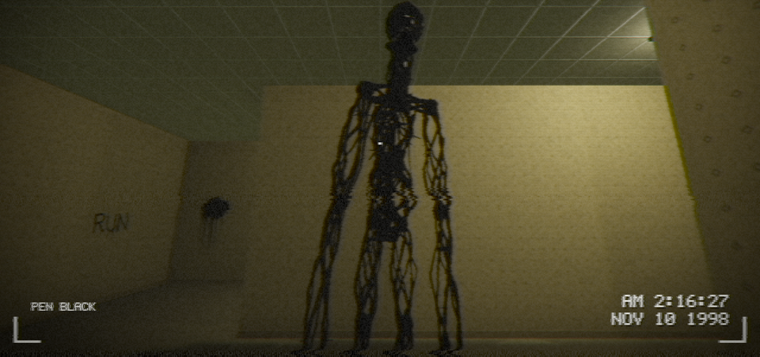

---

## 1. Ficha

| | |
|---|---|
| **Nome** | The BackRooms |
| **Gênero** | Terror em primeira pessoa, exploração e furtividade, fases geradas por seed |
| **Jogadores** | 1 (single player). A rede para até 4 existe no código, mas está escondida do menu desde 21/11/2026 |
| **Plataforma** | Windows 64 bits |
| **Engine** | Unity 6000.6.4f1, HDRP 17.6 |
| **Equipe** | Ver seção 14 e o `README.md` |
| **Disciplina** | Jogos Digitais — Jogos e Interação, Insper, 2026.2 (Projeto 3D) |
| **Entrega** | 25/11/2026 |
| **Língua** | Textos do jogo em inglês; documentação em português |

**Visão geral.** O jogador acorda numa fita VHS de 1998: tudo o que ele vê é a imagem de uma filmadora,
com contador, bateria e data na tela. Ele está preso nos Backrooms, um lugar sem fim feito de cômodos
que se repetem, e precisa passar por quatro fases: os corredores amarelos (Level 0), uma loja de móveis
abandonada (Level 1), piscinas de azulejo alagadas (Level 2) e um andar de escritório vazio (Level 3).
Em cada fase ele cumpre um objetivo que destranca a porta de saída, enquanto foge de um inimigo com
regras próprias: um que ouve, um que só anda quando não é visto, um que caça na água, um que só existe
no escuro e um cego que chega de elevador. Ser pego não mata: a imagem cai (NO SIGNAL) e ele volta ao
começo da fase. A última porta encerra a fita.

> **Para avaliar:** no começo só o Level 0 vem liberado. No menu inicial, **Ctrl + Shift + L** libera as
> quatro fases (de novo, tranca). A gravação de vídeo é na tecla **R**. O menu de pausa (Esc) **não para
> o jogo**.

---

## 2. Conceito e pilares

**Em uma frase:** fugir de cômodos que não acabam, entendendo a regra de cada monstro.

1. **Cada fase tem uma regra para aprender.** O inimigo de cada fase é derrotado por entender o que ele
   percebe: o barulho (Level 0), o olhar com luz (Level 1), a água (Level 2), o escuro e o silêncio
   (Level 3). O jogo não tem armas.
2. **O som é informação.** Passos mudam com o piso; o inimigo ouve o jogador e o jogador ouve o
   inimigo (ronco, perna de pau, rugido, bengala, vassoura, rosnado). Correr é rápido e barulhento; agachar é lento e
   silencioso.
3. **Found footage.** A tela inteira é uma fita VHS (chuvisco, tremido, linhas de varredura), e o
   jogador pode gravar de verdade o que vê (tecla R).
4. **Nunca preso.** Ser pego custa caminho, não a partida. A geração das fases garante sempre um caminho
   seguro até a saída e uma saída de toda água funda (seção 8).
5. **Sempre outra planta.** Cada partida sorteia uma seed e monta outra planta; quem decorou o caminho
   tem de reaprender.

### Referências e inspirações

- **Backrooms** (lenda da internet, "Level 0" e a wiki): os corredores amarelos com carpete úmido e
  zumbido de lâmpada; o "Level 37" para as piscinas. Resumo em `Docs/contexto-backrooms.md`.
- **Filme *Backrooms* (2026)**: a loja de móveis copiada e a figura do Capitão (`Docs/level1-mostruario.md`,
  seção 2.1).
- **MECCHA CHAMELEON**, fase "Backroom": a loja cheia de objetos (`Docs/level1-mostruario.md`, seção 2.2).
- **As *Dream Pools* de Jared Pike** e o jogo **POOLS** (Tensori): as piscinas sem monstro, de luz de
  claraboia (`Docs/level2-piscinas.md`, seção 2).
- **Jogos do gênero** estudados em `Docs/contexto-backrooms.md`: *Escape the Backrooms*, *The Backrooms
  1998*, *The Complex: Found Footage*, *Inside the Backrooms*, *Apeirophobia* e *The Exit 8*.
- **Your Happy Place** para a interface de filmadora (`Docs/referencia-your-happy-place.md`).
- **Um prédio real** (fotos e vídeos de referência, fora do repositório) para o Escritório
  (`Docs/level3-escritorio.md`).

---

## 3. Como se joga

### O ciclo de uma fase

1. **Começa** numa sala segura (a sala inicial; no Escritório, a cabine do elevador). Um cartaz pregado na
   parede, deixado por quem passou por ali, dá **dicas curtas sobre o monstro da fase** ("IT HEARS YOU
   RUN", "STAY IN THE LIGHT") e lembra que **Esc mostra as tarefas**.
2. **Explora** a planta, que muda a cada partida, procurando os pontos do objetivo e a porta de saída.
3. **Cumpre o objetivo** da fase: disjuntores (Level 0), código da porta (Level 1), válvulas que drenam
   (Level 2) ou alarmes de incêndio (Level 3). Até lá a porta fica trancada (a maçaneta chacoalha).
4. **Foge do inimigo** e dos perigos da fase o tempo todo: apagões, buracos, maré, a onda de luzes.
5. **Sai** pela porta (mira + E). A tela mostra `LEVEL N CLEAR`, a fase seguinte é montada e o jogo
   continua nela.

### Vitória e derrota

- **Vencer uma fase:** cumprir o objetivo e atravessar a porta de saída. A fase fica marcada como
  zerada e a próxima é liberada no menu.
- **Vencer o jogo:** atravessar a porta do Level 3. Aparece a tela **END OF TAPE** com o tempo de cada
  fase e o total, e o botão "Back to menu".
- **Derrota não encerra a partida.** Ser pego por um inimigo, cair num buraco ou se afogar corta a
  imagem (`NO SIGNAL`) e, em 0,8 a 1,6 s, o jogador volta ao começo da fase. O que ele já fez continua
  feito: pontos do objetivo armados ficam armados, a porta destrancada fica destrancada, a bateria da
  lanterna fica como estava. O preço da derrota é o caminho de volta e o tempo, que conta na tela final.
  Não há tela de "game over".

---

## 4. Controles e câmera

### Teclas

| Ação | Teclado e mouse | Controle (gamepad) |
|---|---|---|
| Andar | W A S D | Analógico esquerdo |
| Olhar | Mouse | Analógico direito |
| Correr (6 s de fôlego) | Shift | Apertar o analógico esquerdo |
| Agachar | Ctrl ou C | B / Círculo |
| Pular | Espaço | A / Xis |
| Lanterna (liga e desliga) | F | Y / Triângulo |
| Caneta preta, azul, vermelha (de novo: guarda) | 1, 2, 3 | Direcional para cima, esquerda, direita |
| Riscar com a caneta | Botão esquerdo | Gatilho direito |
| Interagir (mira + E) | E | X / Quadrado |
| Gravar a tela (de novo: para) | R | — |
| Menu de pausa (tarefas, teclas, opções) | Esc | Start |
| Menu inicial: jogar | H ou Enter | — |
| **Atalho secreto (menu inicial): liberar todas as fases** | **Ctrl + Shift + L** (de novo: tranca) | — |

O que se faz com **mira + E** (o alvo vale a até uns 9° do centro da tela, sem parede no meio):

- abrir a porta de saída; pegar pilhas da lanterna;
- **segurar E** para armar um disjuntor (3 s), girar uma válvula (6 s; boiando, Espaço e E juntos) ou
  puxar um alarme de incêndio (2 s);
- Level 1: entrar e sair do guarda-roupa ou de baixo da mesa (agachado); abrir o painel do código no
  teclado da porta (digita-se pelos números ou clicando; Backspace apaga, Enter confirma, Esc ou E fecha);
- Level 3: religar um trecho de corredor no interruptor de luz; abrir, fechar ou chamar um elevador;
  sentar numa carteira de sala de aula (E, andar ou pular levanta).

Na água funda (Level 2) não dá pé: **segurar Espaço sobe e boia**; sem tecla, afunda devagar; **Ctrl ou
C mergulha**. Sai-se da água por escada ou subindo numa borda baixa (W, ou Espaço de frente para ela).

### Câmera

- **Primeira pessoa**, com o corpo (o traje amarelo) e a mão segurando a caneta. A mão encolhe perto
  da parede e nunca a atravessa.
- **A câmera é uma filmadora VHS**: o efeito é um passe de pós-processamento próprio (`CamcorderPass` +
  `CamcorderVHS.shader`) com tremido por linha, faixa de tracking, cor que sangra, linhas de varredura e
  ruído. O painel desenhado por cima mostra `STBY` ou `REC`, o contador, a bateria em porcentagem
  (pisca abaixo de 20%), a hora e a data (10/11/1998), avisos do objetivo e o que a tecla E faz no alvo.
- **O chuvisco é um aviso**: a imagem chuvisca perto do inimigo do Level 0 e quando se encara o Capitão
  por tempo demais. Debaixo d'água, a filmadora mostra `WATER` e o fôlego (`AIR`).
- Sensibilidade do mouse ajustável nas opções.

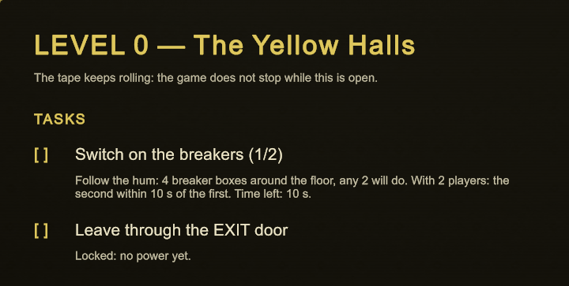

*Menu de pausa do Level 0 (recorte: título e tarefas). Foto tirada num teste com dois jogadores; jogando
sozinho, a linha de detalhe diz "Alone: once on, it stays on."*

---

## 5. As fases

As quatro fases ficam em ordem no menu (`LevelCatalog`): **Level 0 — The Yellow Halls**, **Level 1 —
The Showroom**, **Level 2 — The Poolrooms** e **Level 3 — The Office**. A ficha completa de cada
mecânica, com números, está em `Docs/mecanicas.md`.

### 5.1 Level 0 — The Yellow Halls (os corredores amarelos)

- **Ambiente:** labirinto de 20 x 20 células de 4 m (80 x 80 m), papel de parede amarelo, carpete
  úmido, forro com luminárias fluorescentes que zumbem. Quanto mais longe da sala inicial, mais sujo:
  manchas, sangue, frases nas paredes (RUN, IT HEARS YOU), lâmpadas falhando. Até 6 setas rabiscadas
  apontam o caminho até a saída.
- **Perigos:** **buracos** de 7 m no caminho mais curto, atravessados por vigas de 0,4 m (o jogador tem
  0,6 m: arriscado) ou contornados pelo caminho seguro, que sempre existe. **Apagões:** a partir de 1
  min, a cada 40 s as luzes piscam por 10 s e apagam por 10 s; sobra a lanterna.
- **Inimigo: a entidade** (3,3 m de cipós pretos, cabeça comprida sem olhos). Surge quando o jogador
  se afasta 8 células da sala inicial. **Caça pelo barulho**: correr se ouve a até 8 células; andar, só
  de perto; agachado ou parado, nada. Também **vê** num cone de 130° à frente, até 26 m. Persegue a
  4,6 m/s (o jogador corre a 5,0) e cansa depois de 7 s. Avisa com ronco grave e chuvisco na filmadora.
- **Como escapar:** ficar parado ou agachado fora da vista dela; entrar num **nicho** baixo da parede
  (só agachado; lá dentro ninguém é visto nem pego); atravessar um buraco pela viga (ela não anda nelas);
  voltar à sala inicial (ela não entra).
- **Objetivo: os disjuntores.** A porta está sem energia (`NO POWER`). Quatro caixas na parede, longe do
  início, cada uma **zumbindo de longe** (a pista é o som). Mira + segurar E por 3 s arma uma (a lâmpada
  dela fica verde); sozinho, **duas quaisquer** destrancam (armada, fica armada). Segurar E faz barulho, e
  o estrondo da energia voltando chama a entidade.
- **Como se perde:** pego pela entidade (a menos de 1,25 m, de frente) ou caindo num buraco: NO SIGNAL
  e volta à sala inicial.

### 5.2 Level 1 — The Showroom (o mostruário)

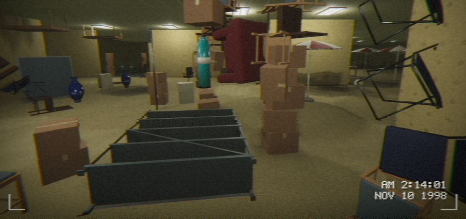

- **Ambiente:** o mesmo labirinto amarelo, mais baixo (3,4 m) e sem buracos, transformado numa loja de
  móveis abandonada: salas de jantar e de estar montadas, estoque, quarto, escritório, lavanderia, festa,
  verão, a sala entupida de sofás e um carro de sorteio. Longe do início aparecem anomalias (mesa no
  teto, móvel atravessando a parede, três salas idênticas). Placas amarelas de curva apontam a saída.
  Os móveis tapam a visão mas **nunca fecham uma passagem**. Toca uma música de loja baixinha, que some
  antes de cada apagão.
- **Inimigo: o Capitão** (2,6 m, mascote de loja vestido de pirata, com perna de pau). **Só anda quando
  ninguém o vê iluminado**: visto na tela e sob luz (luminária acesa perto ou lanterna), congela no
  meio do passo e não pega ninguém. Mas encarar cansa: depois de 6 s o chuvisco cresce, e aos 9 s o
  olhar deixa de valer. Manca devagar (1,7 m/s); **no apagão anda em arrancadas** (5,2 m/s). Também ouve
  e vê como a entidade. Avisa com o "TOC… arrasta" da perna de pau e, de perto, o jingle da loja numa
  caixinha de música.
- **Totens:** 6 a 10 estátuas do Capitão em fibra de vidro, numa base com a placa DISPLAY ONLY. No
  apagão ele pode trocar de lugar com um totem que ninguém vê. Pistas do verdadeiro: a cabeça vira
  devagar para o jogador e a perna de pau deixa marcas redondas no chão.

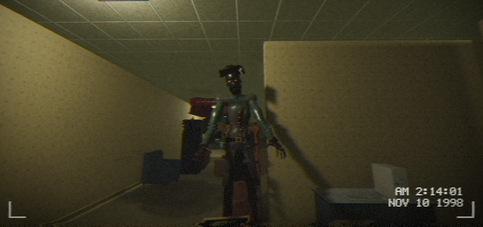

*Um totem (estátua do Capitão, o mesmo modelo dele). Não há foto do Capitão andando em `Logs/Previews`.*

- **Abrigos e armadilhas:** guarda-roupa (esconde sempre; vê-se pela fresta) e debaixo da mesa de jantar
  (agachado; ele vê quem está no cone dele a até 6 m). Plástico-bolha no chão estala alto (conta como
  corrida). Barricadas de móveis do chão ao teto bloqueiam algumas células (nunca isolam nada).
- **Objetivo: o código da porta.** Um teclado ao lado da porta abre um painel na tela. O código de 3
  dígitos está em **três etiquetas vermelhas CLEARANCE** espalhadas pela loja, cada uma com o dígito e a
  posição (1/3, 2/3, 3/3). As outras placas são amarelas: só as do código são vermelhas.
- **Como se perde:** pego pelo Capitão. **Como escapar:** olhar para ele com luz, esconder-se, não
  correr, usar a lanterna no apagão.

### 5.3 Level 2 — The Poolrooms (as piscinas)

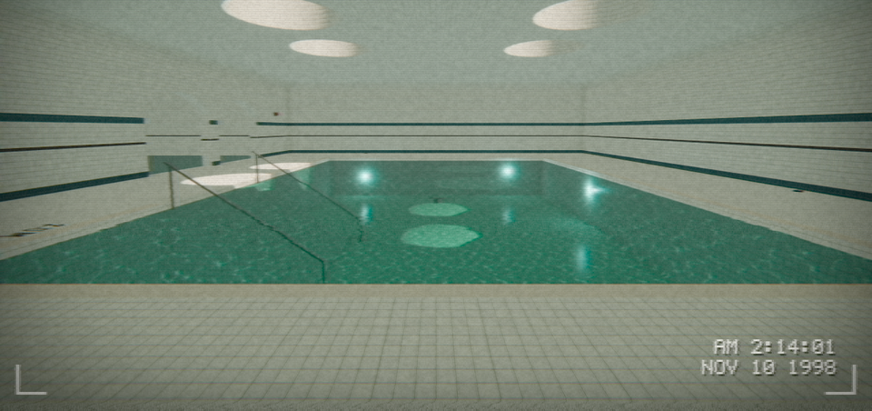

- **Ambiente:** salas de azulejo branco sorteadas (salões de colunas, piscina com deque, raia, canal,
  túnel em abóbada, poços, cisterna escura), com água em quatro alturas: seco, raso (canela), funda (2 m,
  não dá pé) e poço. Sem luminárias: a luz vem de claraboias e janelas. No lugar do apagão, o
  **anoitecer** (a luz esfria, cai e volta).
- **Água:** nado (Espaço sobe, Ctrl mergulha), fôlego de 20 s debaixo d'água. O **caminho até a saída
  nunca exige nadar**; o objetivo exige.
- **A maré:** a cada 90 s toca um alarme (sirene, lâmpadas vermelhas, aviso `TIDE COMING`); a água
  **sobe 1,3 m** em 20 s, fica alta 15 s e desce em 20 s. Na maré alta o raso passa da cabeça (nada-se) e
  o seco fica com água pelo peito; com água acima do joelho não se corre. Na vazante o **ralo** dos poços
  puxa quem nada perto até a grade (afoga).
- **Inimigo: o Undertow** (um afogado esticado de 3,4 m). Na maré baixa vive em qualquer água funda e
  **nunca sai dela**; muda de piscina pelos canos. É **cego e caça pelo barulho na água**: espirro e
  corrida na água chamam de longe, nadar à tona de meia distância, nadar submerso só de muito perto,
  parado nada. **Na maré alta ele ruge e caça no mapa inteiro**, menos a sala inicial. Pega quem está
  com água acima da cintura e o puxa para o fundo. **Quem sai da água escapa** (na maré baixa). Drenada a
  fase, ele se arrasta devagar pelo fundo vazio.

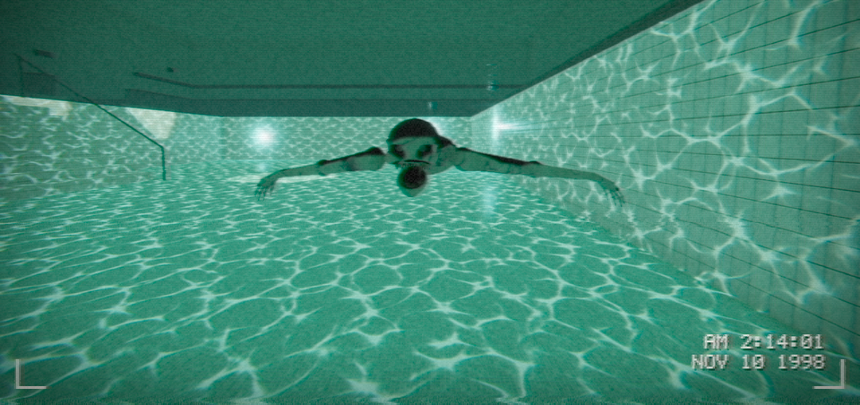

- **Objetivo: drenar.** Duas válvulas vermelhas: uma no seco e outra **do outro lado da água funda**
  (numa ilha ou na parede sobre a água, girada boiando). Girar leva 6 s; sozinho, basta abrir as duas.
  Abertas, a água do mapa desce 2 m, o alarme cala e a saída destranca.
- **Como se perde:** pego pelo Undertow, afogado (fôlego) ou puxado pelo ralo.

### 5.4 Level 3 — The Office (o escritório)

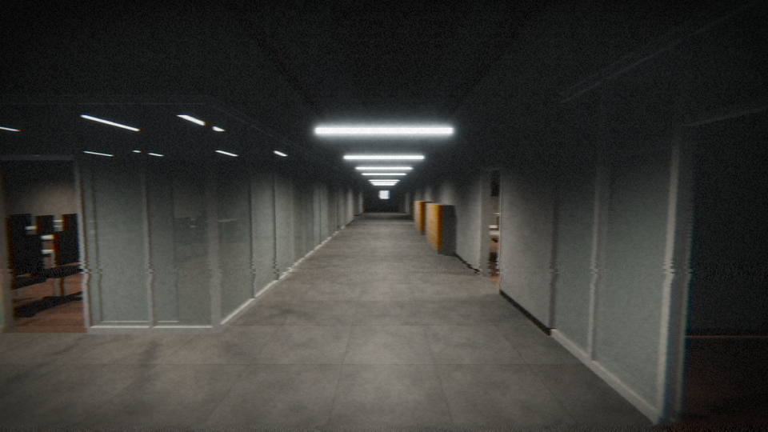

- **Ambiente:** um andar de prédio vazio, 16 x 14 células de 4 m (64 x 56 m): anel de corredores de
  teto técnico, salas de aula (lousas riscáveis, carteiras onde se senta), salas pequenas, saguão de
  elevadores, cafeteria, área de estar e o vão da escada com a saída. Luz fria; ar-condicionado e
  reatores zumbindo. Começa-se dentro da cabine do elevador, que abre sozinha. A saída **se procura**:
  fica do outro lado do andar, atrás de uma porta igual às das salas.
- **A onda de luzes:** a cada ~40 s o trecho de corredor onde o jogador está **pisca 2,5 s** (o reator
  falha no som: hora de sair), apaga por 16 s e volta luminária por luminária. **Interruptores** (mira +
  E) religam o trecho na hora, com um estalo alto, e recarregam 25 s. **Armários** batem em fileira num
  corredor longe, de tempos em tempos.
- **Inimigo 1: o Zelador (The Janitor)** — **só existe no escuro**. Nasce na ponta do trecho que a onda
  apagou, perto de quem ficou dentro; nunca pisa numa célula acesa (quem está na luz está a salvo, mesmo
  a um passo). Enquanto o jogador está na luz, ele **espreita na beira do escuro mais perto**, virado para
  ele, e muda de escuro quando o jogador anda; **pisar no escuro é ser caçado na hora**, até voltar para a
  luz. Vê bem no escuro, ouve mal. A luz voltando o faz afundar no chão. Pistas: a **vassoura seca** varrendo o
  chão, que diz onde ele anda (devagar rondando, aos trancos caçando), e a **voz de caça**, um rosnado rouco
  e grave quando ele começa a correr atrás de alguém, repetido a cada poucos segundos enquanto a caça dura:
  ouvi-lo quer dizer "ele está vindo atrás de você".

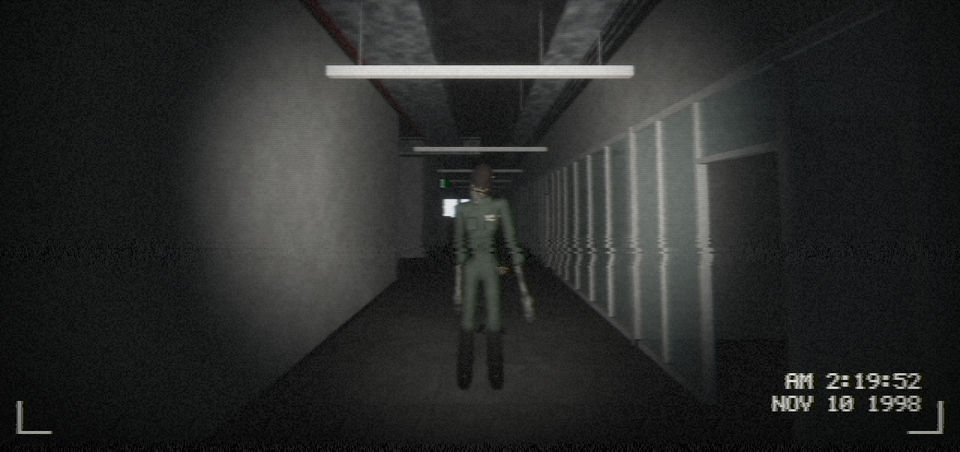

- **Inimigo 2: o Ascensorista (The Attendant)** — **cego, chega de elevador**. A seta de um poço pisca
  5 s, plim, a porta abre e ele escuta antes de sair. Caça só pelo barulho (correr se ouve de longe,
  andar de perto, agachado só na mesma célula); **a 1,5 m ouve a respiração**. Para de tempos em tempos
  para escutar: é a hora de não se mexer. Entra em qualquer sala (a salinha acesa não protege dele). Quem
  ele pega é levado para a cabine dele: a porta fecha e só então cai o sinal. Fica uns 85 s no andar e
  parte. Pistas: a **bengala** batendo no piso duro, que se ouve de longe e vira um arrasto quando ele corre;
  os **estalos da boca** quando para para escutar; a **respiração** chiada, de perto; e o plim do elevador
  que o traz.

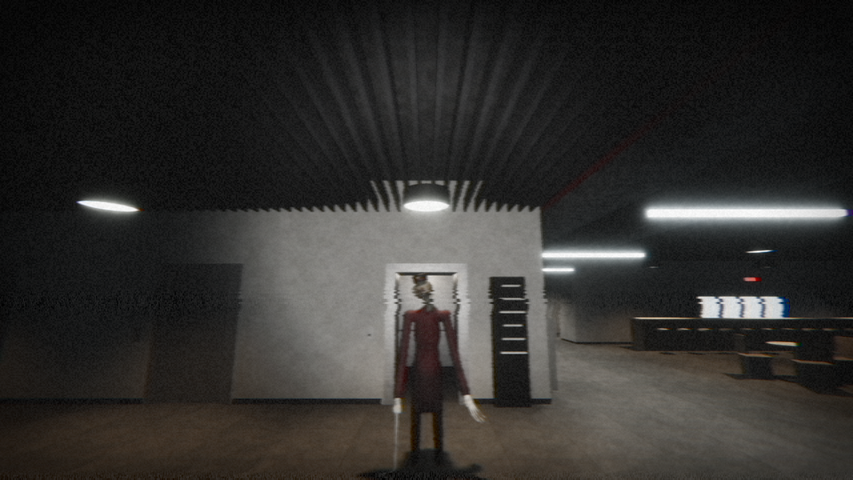

- **A luz salva de um; o silêncio, do outro.** As salinhas acesas protegem do Zelador e não do
  Ascensorista.
- **Objetivo: o alarme de incêndio.** Três acionadores vermelhos, **cada um dentro de uma sala**, fora da
  vista da porta (piscam e zumbem). É preciso puxar os três (2 s cada; sozinho, ficam armados).
  Disparado o alarme, a porta corta-fogo destrava, a sirene chama o Ascensorista e **a energia do andar
  cai**: sobram as salinhas-abrigo e luzes de emergência fracas nas rotas até a escada. A fuga é de ilha
  em ilha de luz.
- **Como se perde:** pego pelo Zelador no escuro ou pelo Ascensorista. A porta da escada é a última do
  jogo: encerra a fita.

---

## 6. Sistemas comuns

- **Lanterna e pilhas.** A lanterna (F) dura 4 min acesa; a bateria aparece em porcentagem na
  filmadora e pisca abaixo de 20%. Cartelas de pilhas no chão, postas pela seed (4 a 9 por mapa; 6 no
  Escritório), recarregam por inteiro (mira + E).
- **Caneta de riscar.** Três cores; risca paredes, chão e teto. Serve para marcar o caminho e os lugares
  onde dá pé nas Piscinas. Não risca debaixo d'água.
- **Esconderijos.** Nichos (Level 0), guarda-roupa e mesa (Level 1); salas iniciais e salinhas acesas do
  Escritório são abrigos.
- **Barulho.** Cada passo faz um barulho que depende da velocidade e do piso (`Footsteps.NoiseOf`); os
  eventos do mundo (armários, estalo do interruptor, estrondo do objetivo) chegam aos inimigos pela
  mesma via (`WorldNoise`). Cada inimigo decide o que ouve.
- **Eventos pelo relógio.** Apagão (Levels 0 e 1), anoitecer e maré (Level 2), onda de luzes e armários
  (Level 3) seguem o relógio da partida.
- **Objetivo comum** (`SwitchObjective`): os disjuntores, as válvulas e os alarmes são o mesmo sistema
  ("N pontos distantes, segurar E"). Com vários jogadores há uma janela de tempo; sozinho, ponto armado
  fica armado.
- **Menu de pausa** (Esc): **o jogo não para** (a fita continua rodando), o jogador só deixa de
  comandar. Mostra as **tarefas** da fase ao vivo (`[X]` feita, `[ ]` a fazer, com uma linha de onde
  ficam os pontos), as **teclas** da fase e os botões Continue, Options, Recordings e Quit to menu.
- **Gravação da tela** (R): grava o que o jogador vê, com o efeito VHS, o painel e o som, num vídeo AVI
  (854 x 480, 20 quadros/s) na pasta `Vídeos\The BackRooms`. O painel mostra `REC` verde com o tempo e
  `SAVED` ao parar; para sozinha aos 15 min. A tela **Recordings** (menu inicial e de pausa) lista os
  clipes, abre, abre a pasta e apaga com confirmação.
- **Opções** (menu inicial e de pausa): volume, sensibilidade do mouse e qualidade (os três perfis do
  HDRP: High Fidelity, Balanced, Performant). Guardadas no computador.
- **Progressão e desbloqueio.** Ficam liberadas as fases zeradas e a próxima; a lista "Level" do menu
  marca `[cleared]` nas zeradas. O progresso fica guardado neste computador. **Atalho secreto:** Ctrl +
  Shift + L no menu inicial libera todas as fases (aviso `ALL LEVELS UNLOCKED`); de novo, tranca outra vez
  (`LEVELS LOCKED AGAIN`) sem apagar o progresso de verdade. No editor do Unity e em build de
  desenvolvimento tudo já vem liberado.
- **Menu inicial.** A fase escolhida aparece montada atrás do menu; só a música do menu se ouve.

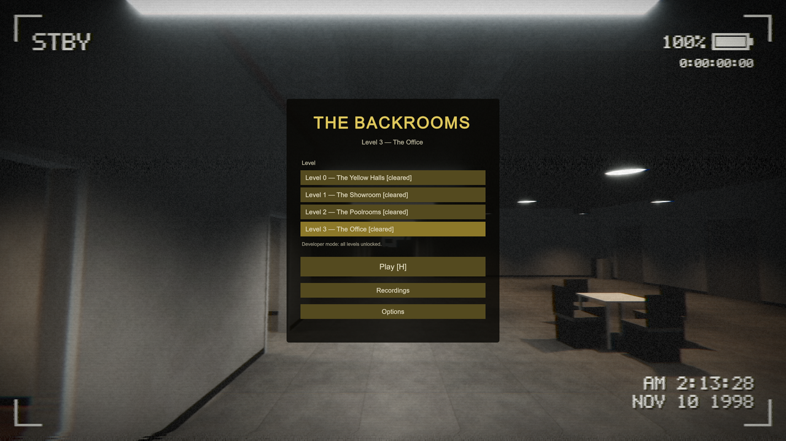

*Menu inicial, capturado no editor (por isso a nota "Developer mode: all levels unlocked" e todas as fases
liberadas).*

---

## 7. Estados do jogo

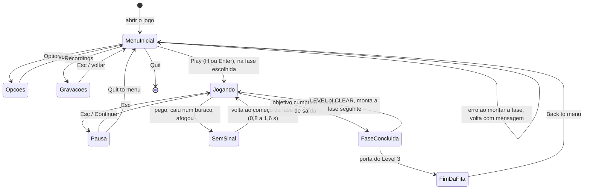

| Estado | O que acontece | Para onde vai |
|---|---|---|
| **Menu inicial** | Título, lista de fases (liberadas e zeradas), Play, Recordings, Options e Quit. A fase escolhida aparece montada atrás, muda; toca a música do menu. | Play começa a fase escolhida já jogando (a partida de um jogador hospeda só na própria máquina, em 127.0.0.1); Quit fecha o jogo. |
| **Erro ao montar a fase** | Se a fase falha ao ser montada, o jogo não fica numa tela travada: volta ao menu inicial com uma mensagem. | Menu inicial. |
| **Jogando** | O jogador comanda; a fita roda; relógio da fase correndo. | Pausa, sem sinal, fase concluída. |
| **Pausa** | Tarefas, teclas, opções. **O jogo não para**: o jogador ainda pode ser pego. | Continue (ou Esc) volta; Quit to menu encerra a partida e volta ao menu. |
| **Sem sinal (pego)** | Tela preta `NO SIGNAL`. Pelo Ascensorista, antes aparece na cabine dele e a porta fecha. | Volta ao começo da fase (sala inicial ou cabine), com o progresso da fase mantido. |
| **Fase concluída** | Porta aberta com o objetivo cumprido: `LEVEL N CLEAR`, fase marcada como zerada, a próxima liberada e montada. | A fase seguinte, já jogando. |
| **Fim da fita** | Depois do Level 3: `END OF TAPE`, "You got out. For now.", o tempo de cada fase e o total. | Back to menu. |
| **Recomeçar** | Esc > Quit to menu > Play recomeça a fase do zero, com outra seed (outra planta). Depois do fim da fita, Back to menu e a lista "Level" deixam escolher qualquer fase liberada. | Jogando. |
| **Sair** | Botão Quit no menu inicial (do jogo, Esc > Quit to menu > Quit). | Fecha o jogo. |

### O que impede o jogador de ficar preso (dead ends)

Regras garantidas pela geração das fases e conferidas por testes automáticos:

- **Buraco nunca isola parte do mapa** (Level 0): toda célula continua alcançável sem pisar em viga;
  sempre há um caminho seguro até a saída (`LevelData.SafePathCells`).
- **Móvel nunca fecha passagem** (Level 1): cada célula tem uma cruz livre de 1,2 m; móvel que invada é
  recusado ao ser posto. Barricadas só entram se nada ficar isolado. Nenhum móvel invade a sala inicial
  nem a saída.
- **Nas Piscinas, de toda água funda se sai** (por escada ou borda), o caminho até a saída nunca exige
  nadar e, na maré alta, de todo raso se chega a pé a um lugar para respirar. Conferido jogando com
  teclado virtual em várias seeds (`Level2EscapeTest`, `Level2HighTideTest`).
- **No Escritório, tudo se alcança da cabine**, o caminho até a escada e a escada até a porta ficam
  livres para o corpo do jogador e nenhuma passagem das salas de aula fica fechada por móvel; onde um
  móvel fecha uma passagem, os inimigos não a usam (`OfficeGenerator.Validate`, `Level3Setup.BatchCheck`).
- **Planta que reprova é sorteada de novo** (Piscinas e Escritório têm `Validate`; o gerador tenta de novo
  até passar).
- **Toda interação tem saída:** o painel do código fecha com Esc ou E; esconderijo sai com E; carteira
  levanta andando; elevador com alguém no vão reabre; menu de pausa volta com Esc.
- **Derrota nunca apaga o progresso da fase** (seção 3). Abrigos fixos em toda fase (sala inicial que os
  inimigos não pisam; no Escritório, a cabine e as salinhas acesas para o Zelador).

---

## 8. Arte

- **Direção:** fotografia de fita VHS de 1998, cores apagadas, luz de lâmpada fluorescente. Cada fase tem
  paleta e perfil de iluminação próprios (amarelo-esverdeado no Level 0 e 1, azulejo creme e água
  verde-água no Level 2, cinza frio no Level 3).
- **Geometria das fases:** paredes, pisos, tetos, buracos, piscinas, escadas e o prédio do Escritório
  são montados em código a partir da planta (`LevelBuilder`), com colisor e malha nascendo juntos.
- **Modelos 3D feitos por script no Blender** (próprios): **65 móveis** do Level 1 em 9 lotes
  (`Tools/Blender/lotes`, FBX; `Docs/modelos-blender.md`, seção 7) e os **cinco inimigos esculpidos**
  (entidade, Capitão, Undertow, Zelador, Ascensorista): esculpidos por funções de distância, reduzidos a
  ~40 mil triângulos, com cor e relevo assados em 2048 px e pesos por junta; vestidos sobre esqueletos
  montados e animados em código (`Tools/Blender/personagens`).
- **Modelos gerados por IA:** a **porta de saída** (GLB gerado por texto na Tripo pelo Higgsfield; lido por
  um leitor de GLB próprio, `GlbReader`); o **traje dos jogadores** e a **caixa do disjuntor** (Tripo),
  reduzidos e reprocessados no Blender por script (`Tools/Blender/tripo`).
- **Texturas:** do Level 0 (papel de parede, carpete, forro, concreto) e do Level 2 (azulejo, pastilha,
  capa da borda, ondulação, cáustica, vidros, manchas e marcações) geradas por IA no Higgsfield e
  preparadas para emendar sem costura; as demais (Level 3, sujeira, materiais dos inimigos) pintadas em
  código. Materiais HDRP/Lit; decalques para sujeira, sangue, frases e marcações.
- **Iluminação (HDRP):** luminárias com sombra em cache e céu de luz ambiente (Levels 0 e 1); luz só de
  claraboias e janelas, com uma luz de "sol" inclinada, água transparente com refração e cáustica (Level
  2); tubos frios com sombra de uma face e Volume próprio (Level 3). Lanterna com facho volumétrico.
- **Efeito VHS:** passe próprio do HDRP (`CamcorderPass`, `CamcorderVHS.shader`) e fonte de pixels 5x7
  própria (`PixelFont`) no painel. Menus em UI Toolkit.

## 9. Áudio

- **Tudo sintetizado em código**, sem arquivos de som: passos por piso (carpete, laminado, vinílico,
  azulejo, piso duro do Escritório, água rasa, nado, debaixo d'água, espirro; agachado, andando e
  correndo), os sons dos cinco inimigos (ronco e rugido, perna de pau e jingle, rugido e rosnado na água;
  no Escritório, a vassoura seca e o rosnado de caça do Zelador, e a bengala, os estalos da boca e a
  respiração do Ascensorista), música de loja, sirene e buzina da maré, ralo, ar-condicionado
  e reatores, armários, elevador, interruptor, porta.
- **Única exceção:** a música do menu, a faixa ***7 Weeks and 3 Days*** (música de terceiros, conhecida de
  vídeos de Backrooms; `Assets/_Game/Audio/Musica/Menu_Tema.mp3`; créditos no `README.md`).
- Som em 3D: o jogador localiza o inimigo pelo ouvido. No menu, a fase montada atrás fica muda.
- **Regra de síntese** (aprendida em 23/11/2026): passos, impactos e rangidos não levam tom afinado nem
  glissando; a cor do material vem de ruído filtrado. Senão soam como "pato de borracha" (seção 11).

## 10. Tecnologia e desempenho

- **Unity 6000.6.4f1 com HDRP 17.6**; Input System novo (ações criadas em código, teclado, mouse e
  controle); interface em **UI Toolkit**; Netcode for GameObjects 2.13.3 (a rede continua por baixo:
  jogar sozinho é hospedar sem ninguém entrar).
- **Geração procedural determinística:** cada fase nasce de uma seed, só com `System.Random(seed)`. Um
  gerador por tipo de fase: `LevelGenerator` (labirinto), `PropLayer` (mobília do Level 1),
  `PoolGenerator` (piscinas por salas) e `OfficeGenerator` (escritório), os dois últimos com `Validate` e
  `Hash`. Mesma seed, mesma planta, em qualquer máquina.
- **IA dos inimigos sem NavMesh:** caminho na grade da planta (`LevelNav`), sentidos e decisão num
  cérebro base (`EntityBrain`) que cada inimigo estende por ganchos.
- **Colisões:** colisor e malha visível nascem juntos; uma ferramenta compara milhares de raios contra o
  que aparece na tela em várias seeds (0 diferenças em 48.000 raios no Level 0). Os inimigos conferem cada
  passo com uma cápsula e deslizam ao longo do obstáculo; o Undertow confere o corpo inteiro. O raio que
  sai da câmera (caneta, interação) ignora o próprio jogador.
- **Desempenho, o que foi feito:** malhas juntas (as peças dos inimigos fundidas numa malha por junta;
  calhas, grelhas, difusores e portas de armário do Escritório em poucas malhas: de 262 para 82 objetos
  desenhados), sombras em cache (uma face só nas Piscinas e no Escritório), limite de luminárias acesas,
  distância em que as luzes somem (25 a 28 m), névoa só na lanterna, decalques que somem a 25 m, perfis de
  qualidade nas opções. Medido no Level 0 numa Quadro T2000: cerca de 20 ms por quadro (12/11/2026). Em
  computador com vídeo integrado, o jogo já começa no perfil "Performant" (o jogador troca nas opções).
- **Testes automáticos:** dezenas de testes rodados pelo editor (fumaça, um por fase, um por inimigo,
  fuga da água, objetivo, menus) e conferências dos geradores em várias seeds (lista no `CLAUDE.md`,
  "Como testar"). As rodadas finais (21/11 e 23/11) foram testadas jogando.

---

## 11. Mudanças de trajetória

| Quando | O que mudou | Por quê |
|---|---|---|
| 10/11/2026 | Início: Unity 6000.3 com HDRP. Conceito original **co-op de 1 a 4 por IP**, com quatro forças: ficar junto (sanidade), se separar (objetivos), falar (voz) e ficar calado (inimigo que ouve) (`Docs/plano-coop.md`). | A proposta inicial era um terror cooperativo. |
| 10/11 | Decidido ficar no HDRP; PCs fracos usam o perfil "Performant". | Manter a iluminação e o efeito VHS do HDRP; para PCs modestos a saída é o perfil de qualidade, não trocar de pipeline (`Docs/plano-coop.md`, seção 4). |
| 11/11 | A entidade de figura preta com costelas foi redesenhada: cipós e cabeça comprida sem olhos. | O primeiro desenho não agradou. |
| 11/11 | Unity 6000.3 → **6000.6.4f1** (HDRP 17.3 → 17.6). | A máquina de desenvolvimento só tinha esse editor. |
| 11/11 | Modelos e texturas por IA (Higgsfield/Tripo): a porta entrou; a grelha de ar foi recusada e virou geometria em código. Móveis passam a ser feitos **no Blender por script**. | A grelha saiu torta; script é repetível e fica no Git. |
| 12/11 | Level 2: a primeira versão (o labirinto com azulejo e água) foi **rejeitada** e refeita como salas sorteadas, a partir de uma pesquisa de ~130 imagens. | Ficava "igual às salas amarelas com outras cores". |
| 12/11 | **Inimigos de peças em código → esculpidos no Blender** e vestidos sobre juntas em código. | Esferas e cápsulas davam cara de balão e de brinquedo. |
| 12/11 → 20/11 | A luz ambiente do Level 0 foi desligada por desempenho e depois religada. | Deixava cantos pretos e não rendia em tempo de quadro. |
| 17/11 | O Capitão no Level 1 e a primeira versão do Escritório. **Sanidade trocada por chuvisco** ao encarar o Capitão. | Sanidade era um sistema grande demais para o prazo. |
| 19/11 | **Plano de entrega:** toda fase com algo a fazer (objetivo) e algo a temer; objetivo comum. Ficam de fora a voz por proximidade, o código de sala (Relay), a sanidade e a sala de contenção (o pego volta ao começo). | Fechar o jogo como produto até 25/11 (`Docs/plano-de-acao.md`). |
| 19/11 → 21/11 | O Level 3 usaria a entidade do Level 0; depois de jogar, ganhou **dois inimigos próprios** (Zelador e Ascensorista), e o Level 2 ganhou o Undertow. A maré ficou mais forte e uma válvula passou a exigir nado. | Pedido de quem jogou: uma regra por fase; o Level 2 estava fácil. |
| 21/11 | **Texto do jogador em inglês**; menu de pausa com as tarefas; cartazes de dicas no lugar dos bilhetes. | Pedido do usuário depois de jogar. |
| 21/11 | Traje dos jogadores e disjuntor da Tripo. | O traje era uma figura de peças em código e o disjuntor, uma caixa de peças primitivas. |
| 21/11 (tarde) | **Co-op → single player**: o menu não mostra mais Host, Join nem endereço; a rede fica no código. Os testes passam a ser feitos **jogando**. A gravação passou de F9 para **R**. | Decisão da equipe, para simplificar o escopo; o F9 não chegava ao jogo na máquina do usuário. |
| 23/11 | **Sons de "pato de borracha" removidos** (válvula, porta, rodízio do Zelador, vinílico) e **passos refeitos** só com ruído filtrado. | Quem jogou achou os passos esquisitos e ouviu um "pato"; a causa era tom afinado variando de altura. |
| 23/11 | **Som do Zelador mais limpo:** saíram botas, chaves, rodízio, balde e torcer o pano; ficou a vassoura seca varrendo o chão e entrou uma **voz de caça** (rosnado rouco quando ele corre atrás de alguém). O Ascensorista mantém a bengala, os estalos da boca e a respiração. | Pedido do usuário depois de jogar o Level 3: menos ruído sem sentido e um aviso claro de que o Zelador está perseguindo. |
| 23/11 | Escritório de 14 x 12 para **16 x 14** células; menos objetos desenhados; inimigos que não atravessam móveis. | Pedido de "expandir um pouco sem mudar a experiência". |
| 23/11 | O Capitão fica como está, perto do personagem do filme *Backrooms* (2026), com crédito ao filme como referência visual (decisão em aberto 4 de `Docs/level1-mostruario.md`, fechada). | Decisão da equipe. |
| 23/11 | **Cartazes das salas iniciais falam do monstro** de cada fase (sete dicas curtas), e o Level 1 ganhou o dele. | Quem avalia joga sem ler documentação: o cartaz é a instrução dentro do mundo. |
| 23/11 | Botão Quit no menu inicial; a partida de um jogador hospeda só em 127.0.0.1; erro ao montar a fase volta ao menu com mensagem. | Acerto dos estados do jogo: sair sem fechar a janela e não ficar numa tela travada se a fase falhar. |
| 23/11 | Atalho Ctrl + Shift + L que libera todas as fases. | Para a build do itch.io (avaliação sem precisar zerar tudo). |

**Fases planejadas e entregues.** O plano de 10/11 previa "mais níveis, cada um com regra própria",
sem número. Foram entregues quatro, todas com objetivo e inimigo. O Level 0 tinha a saída planejada como
um elevador sem energia com painel de código; virou a porta com disjuntores.

**Escopo.** O escopo do jogo (quatro fases, um inimigo próprio em cada uma, geração procedural) foi
discutido e combinado com o professor da disciplina.

---

## 12. Fora do escopo e ideias

Não estão no jogo (detalhes em `Docs/mecanicas.md` e `Docs/plano-de-acao.md`, "Fora da entrega"):

- **Co-op na interface** (a rede por IP existe e foi testada em dois editores, mas o menu está em single
  player), entrar por código de sala (Relay) e **voz por proximidade**.
- **Sanidade** e alucinações; **sala de contenção** com resgate por um colega.
- Itens além da caneta e das pilhas (walkie-talkie, Almond Water).
- Level 0: painel de código. Level 2: casas de máquinas, porta no fundo do poço, túneis submersos, a
  válvula no fundo de um poço (pronta no código e desligada). Level 3: modelos do cenário feitos no
  Blender (hoje caixas e tubos em código), cadeiras viradas, telas que ligam.
- Propostas não decididas (`P0.1` a `P2.5` em `Docs/mecanicas.md`): a entidade que imita passos, o
  labirinto que muda no apagão, a loja que se rearruma, entre outras.

## 13. Decisões de projeto que o jogador deve saber

- **O menu de pausa não para o jogo** (a fita continua rodando, e o próprio menu avisa: "The tape keeps
  rolling"). A sala inicial de cada fase é segura: é o lugar para abrir o menu e ler as tarefas.
- **Teclado e mouse** são o esquema de controle do jogo.
- **Qualidade gráfica:** o menu de opções tem três perfis (High Fidelity, Balanced, Performant); em
  computador com vídeo integrado, o jogo já começa no "Performant".

## 14. Equipe e créditos

Equipe (três integrantes): Marcos Augusto Rossi Paulino Costa, Raphael Barbuti e Lucas Kamikawa
(LKenji no Git). Créditos dos assets, das
referências e das ferramentas, incluindo o uso de assistente de IA (Claude Code) na programação e na
documentação: **`README.md`**.
