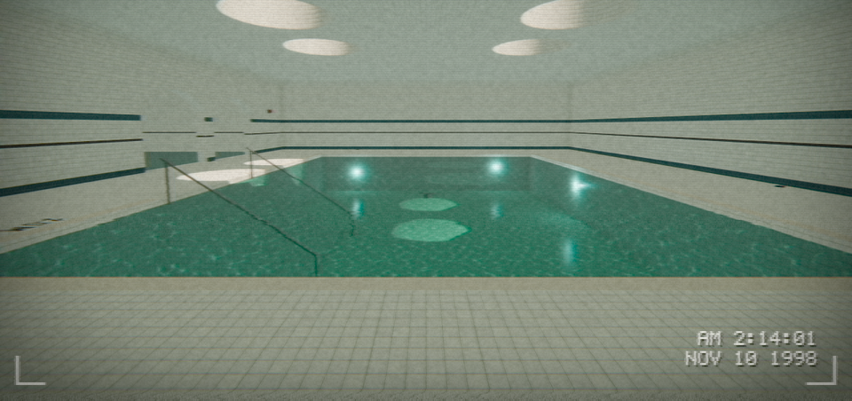

# The BackRooms

Terror em primeira pessoa para um jogador, feito em Unity (HDRP) para a disciplina Jogos Digitais do
Insper (2026.2). Você está preso numa fita VHS de 1998, dentro dos Backrooms: quatro fases que mudam a
cada partida, cada uma com um objetivo que destranca a saída e um monstro com regras próprias.



O documento de design completo, com as mudanças de rumo do projeto, está no **[GDD.md](GDD.md)**.

> **Para avaliar sem zerar tudo:** no começo só o Level 0 vem liberado. No menu inicial, aperte
> **Ctrl + Shift + L** para liberar as quatro fases na lista "Level" (aparece `ALL LEVELS UNLOCKED`).
> Apertando de novo, elas voltam a trancar.

---

## Como jogar

Ache a saída de cada fase. **A porta só destranca depois do objetivo da fase.** Esc abre o menu de
pausa com as tarefas da fase. **Atenção: o menu de pausa não para o jogo** (a fita continua rodando, e
um monstro ainda pode pegar você). Ser pego, cair ou se afogar não
mata: a imagem cai (NO SIGNAL) e você volta ao começo da fase, com o que já tinha feito.

### Teclas

| Tecla | Ação |
|---|---|
| W A S D / mouse | Andar / olhar |
| Shift | Correr (6 s de fôlego; faz muito barulho) |
| Ctrl ou C | Agachar (quase sem barulho) |
| Espaço | Pular; na água funda, segurar para subir e boiar |
| F | Lanterna (a bateria acaba; pilhas no chão recarregam) |
| 1, 2, 3 | Caneta preta, azul, vermelha (de novo: guarda) |
| Botão esquerdo | Riscar paredes, chão e teto com a caneta |
| E (mirando) | Interagir: porta, pilhas, esconderijos, teclado da porta, interruptores, elevadores |
| Segurar E (mirando) | Armar disjuntor, girar válvula, puxar alarme de incêndio |
| R | Gravar a tela em vídeo (de novo: para). Os clipes ficam em `Vídeos\The BackRooms` |
| Esc | Menu de pausa: tarefas, teclas, opções, gravações, voltar ao menu |
| H ou Enter | No menu inicial: jogar a fase escolhida |

Dentro das fases também dá para jogar com controle (analógicos andam e olham, A pula, B agacha, Y
lanterna, X interage, Start pausa); o menu inicial e a gravação são pelo teclado e mouse.

A qualidade gráfica tem três perfis em **Options** (High Fidelity, Balanced, Performant); em computador
com vídeo integrado, o jogo já começa no "Performant".

**Segredo:** no menu inicial, **Ctrl + Shift + L** libera todas as fases na lista "Level" (aparece
`ALL LEVELS UNLOCKED`). Apertando de novo, elas voltam a trancar, sem perder o seu progresso.

### As fases

| Fase | Objetivo | O monstro e como escapar |
|---|---|---|
| **Level 0 — The Yellow Halls** | Ligar 2 dos 4 disjuntores (siga o zumbido; mira + segurar E). | **A entidade** ouve: não corra perto dela. Esconda-se agachado nos nichos das paredes, atravesse buracos pela viga ou volte à sala inicial. Cuidado com os buracos e com os apagões. |
| **Level 1 — The Showroom** | Achar as três etiquetas vermelhas **CLEARANCE** (1/3, 2/3, 3/3) e digitar o código no teclado da porta. | **O Capitão** só anda quando ninguém o vê iluminado: olhe para ele com luz (mas não por mais de alguns segundos). No apagão, use a lanterna. Guarda-roupas e mesas escondem. Desconfie das estátuas. |
| **Level 2 — The Poolrooms** | Abrir as duas válvulas: uma no seco, outra do outro lado da água funda (é preciso nadar). | **O Undertow** é cego e caça pelo barulho na água; sair da água salva. Quando o alarme tocar, a maré sobe 1,3 m: procure o seco e não nade perto dos ralos quando a água baixar. |
| **Level 3 — The Office** | Puxar os três alarmes de incêndio, cada um dentro de uma sala. Depois, descer a escada até a porta corta-fogo. | **O Zelador** só existe no escuro (ouve-se a vassoura seca varrendo o chão e, quando ele corre atrás de você, um rosnado rouco): fique na luz e religue os interruptores. **O Ascensorista** é cego e chega de elevador (ouve-se a bengala batendo no piso): quando ele parar para escutar, estalando a boca, não se mexa. |

A porta do Level 3 encerra a fita, com o seu tempo em cada fase.

---

## O projeto

- **Unity 6000.6.4f1** (HDRP 17.6, Input System, UI Toolkit, Netcode for GameObjects). Abra a pasta
  pelo Unity Hub com essa versão. A cena que a build abre é `Assets/_Game/Scenes/Level0_Test.unity`.
- **Gerar a build para Windows:** menu **BackRooms > Gerar build para Windows**, ou por linha de
  comando, com o editor fechado:

  ```
  "C:\Program Files\Unity\Hub\Editor\6000.6.4f1\Editor\Unity.exe" -batchmode -projectPath "<pasta do projeto>" -executeMethod BackRooms.EditorTools.BuildTool.BatchWindows -logFile build.log
  ```

  O jogo sai em `Builds/Windows/TheBackRooms.exe` (a primeira vez leva bastante tempo).
- **As fases não ficam prontas na cena:** cada uma é montada ao jogar a partir de uma seed. Cenas,
  materiais e prefabs são gerados por ferramentas do menu **BackRooms** (ver `CLAUDE.md`, "Conteúdo
  gerado").

### Pastas

| Pasta | O que tem |
|---|---|
| `Assets/_Game/Scripts` | Todo o código: `World` (geradores e fases), `Player`, `Entities` (inimigos), `Items`, `UI`, `Audio`, `Network`, `Systems`, `Editor` (ferramentas e testes) |
| `Assets/_Game/Art` | Materiais, texturas e modelos; `Art/Fontes` guarda os originais gerados por IA |
| `Assets/_Game/Scenes` | Uma cena por fase |
| `Tools/Blender` | Scripts que geram os móveis e esculpem os inimigos no Blender |
| `Tools/` | Compilação rápida e a fila do Unity e do Blender |
| `Docs/` | Projeto de cada fase, mecânicas, plano, histórico, referências; `Docs/imagens` tem as fotos deste README e do GDD |

Leitura: [GDD.md](GDD.md) (o jogo), `Docs/mecanicas.md` (as regras de cada fase), `Docs/historico.md`
(o que foi feito em cada dia), `CLAUDE.md` (regras de código e como testar).

---

## Créditos e referências

### Feito pela equipe

- **Código, geração das fases, IA dos inimigos, interface e ferramentas**, em C#. A equipe programou com
  ajuda de assistente de IA: **Claude Code** (Anthropic), usado na programação, nos scripts do Blender,
  nos testes e na documentação.
- **Modelos 3D feitos por script no Blender:** os 65 móveis do Level 1 e os cinco inimigos esculpidos
  (entidade, Capitão, Undertow, Zelador, Ascensorista) (`Tools/Blender`).
- **Geometria das fases** (paredes, piscinas, prédio do Escritório) e **texturas pintadas em código**
  (Level 3, sujeira, inimigos).
- **Todos os sons**, sintetizados em código (passos, monstros, ambiente, música de loja), menos a música do
  menu.
- **Efeito VHS** (shader e passe do HDRP) e a **fonte de pixels 5x7** do painel da filmadora
  (`PixelFont`, desenhada em código, sem arquivo de fonte). Os menus usam a fonte padrão do Unity (UI
  Toolkit).

### Gerado por IA (ferramentas externas)

| Asset | Origem | Onde está |
|---|---|---|
| Porta de saída (modelo 3D) | Tripo (texto para 3D), pelo Higgsfield | `Assets/_Game/Art/Fontes/ExitDoor.glb` |
| Texturas do Level 0 (papel de parede, carpete, forro, concreto) | Higgsfield, GPT Image 2.6; emendadas por script | `Assets/_Game/Art/Fontes/Texturas` |
| Texturas do Level 2 (azulejo, pastilha, borda, água, cáustica, vidros, manchas, marcações) | Higgsfield (folhas A a D; prompts em `Docs/level2-prompts.md`) | `Assets/_Game/Art/Fontes/Level2` |
| Traje dos jogadores e caixa do disjuntor | Tripo, reduzidos e reprocessados no Blender por script | `Assets/_Game/Art/Fontes/Traje`, `Art/Fontes/Alavanca`, `Tools/Blender/tripo` |

### Outros

- **Música do menu:** a faixa ***7 Weeks and 3 Days***, música de terceiros conhecida de vídeos de
  Backrooms (`Assets/_Game/Audio/Musica/Menu_Tema.mp3`).
- **Unity** e pacotes: High Definition Render Pipeline, Input System, UI Toolkit, Netcode for GameObjects.
  Restos do template HDRP do Unity continuam em `Assets/` (`OutdoorsScene`, `TutorialInfo`) e não entram
  na build.
- **Blender 5.3**, usado por linha de comando para gerar os modelos.
- `.gitignore` e `.gitattributes` partem dos modelos públicos do GitHub para Unity (créditos no topo de
  cada arquivo).

### Referências e inspirações

- **Backrooms**, a lenda da internet, e a wiki dos Backrooms (Level 0; Level 37 para as piscinas).
- **Filme *Backrooms* (2026)**: a loja de móveis e a **referência visual do Capitão**, desenhado a partir
  de imagens do filme (decisão de 23/11/2026: o desenho fica como está, com este crédito ao filme).
- **MECCHA CHAMELEON** (fase "Backroom"), as ***Dream Pools* de Jared Pike** e **POOLS** (Tensori).
- **Your Happy Place** (interface de filmadora) e os jogos estudados em `Docs/contexto-backrooms.md`
  (*Escape the Backrooms*, *The Backrooms 1998*, *The Complex: Found Footage*, *Inside the Backrooms*,
  *Apeirophobia*, *The Exit 8*).
- Fotos e vídeos de um prédio real como referência do Escritório (fora do repositório).

---

## Equipe

- Marcos Augusto Rossi Paulino Costa ([marcoss0ft](https://github.com/marcoss0ft))
- Raphael Barbuti ([Rabarbuti](https://github.com/Rabarbuti))
- Lucas Kamikawa ([lucaskmk](https://github.com/lucaskmk), LKenji nos commits)

Jogos Digitais — Jogos e Interação, Insper, 2026.2. Professores: Luciano Soares e Gustavo Braga;
técnico: Pedro Emil.
